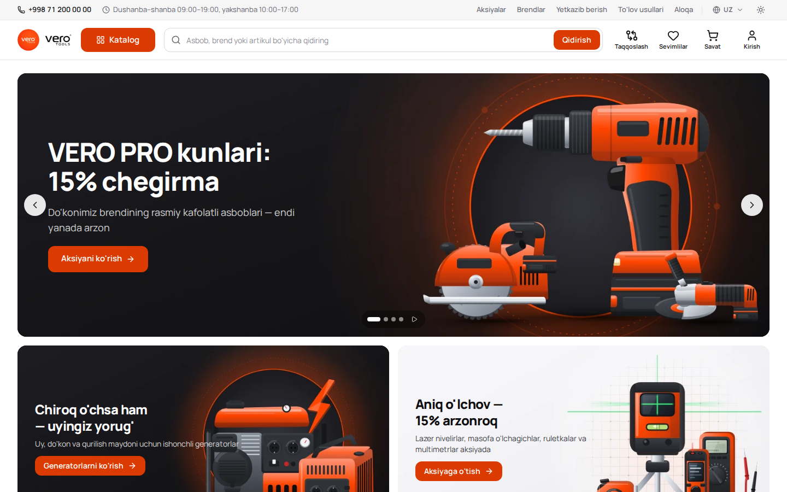
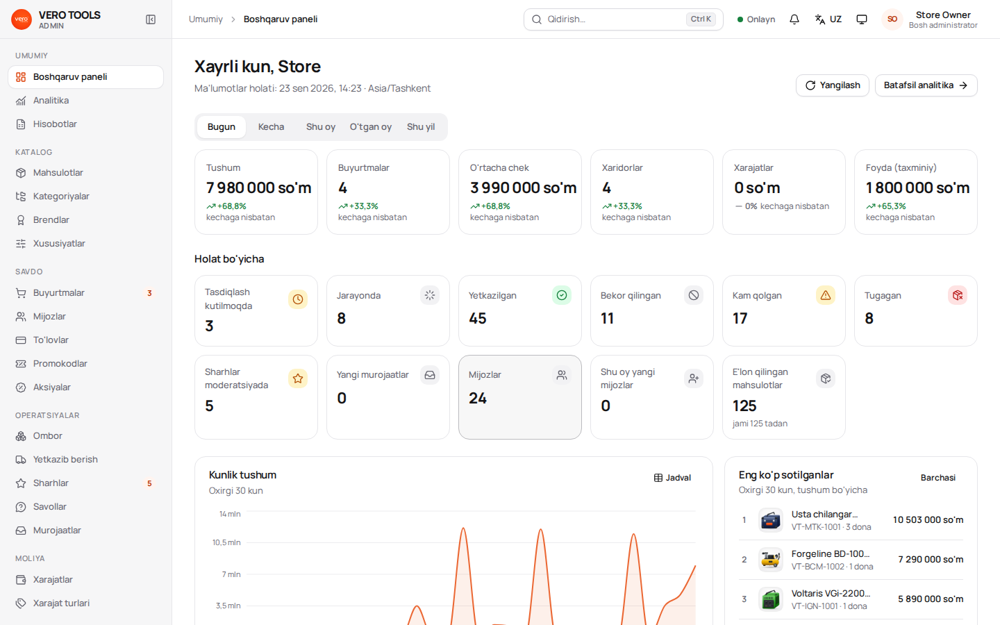
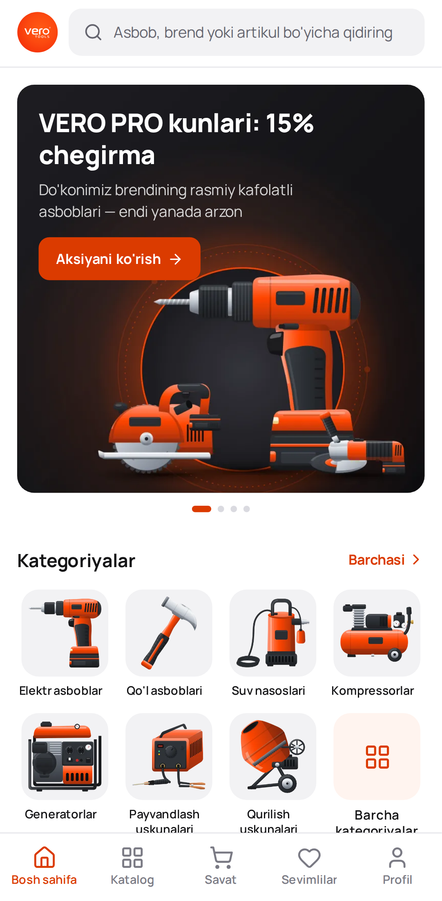
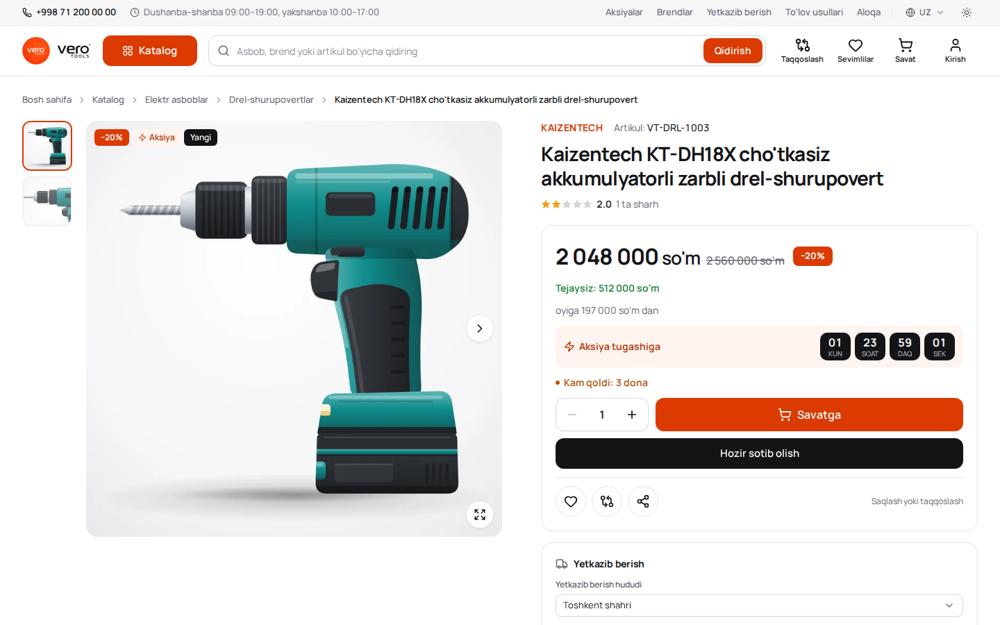
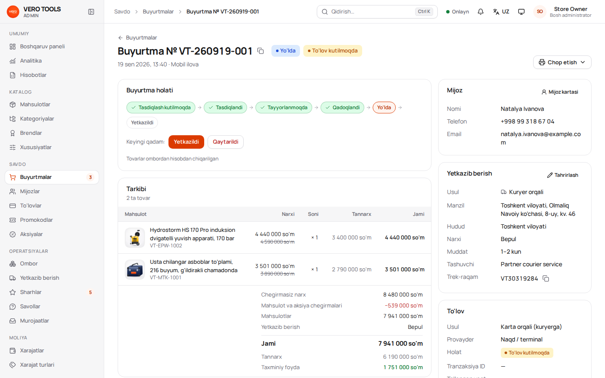
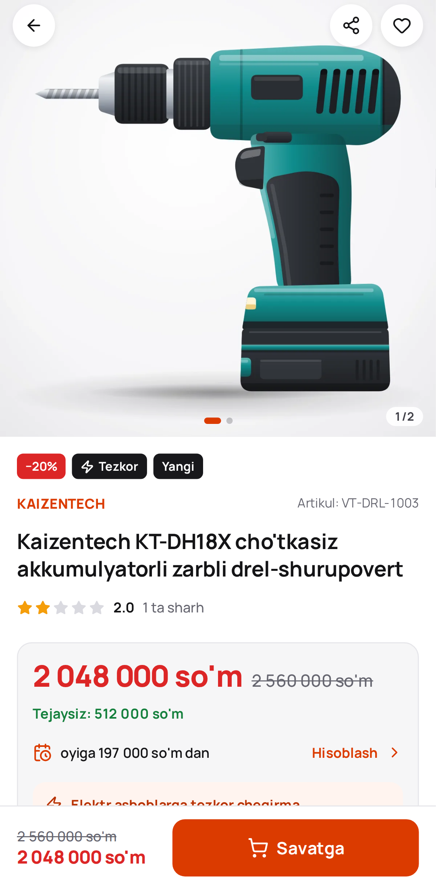
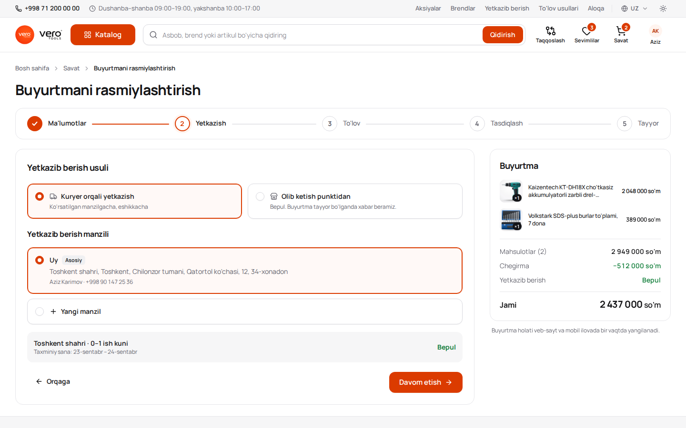
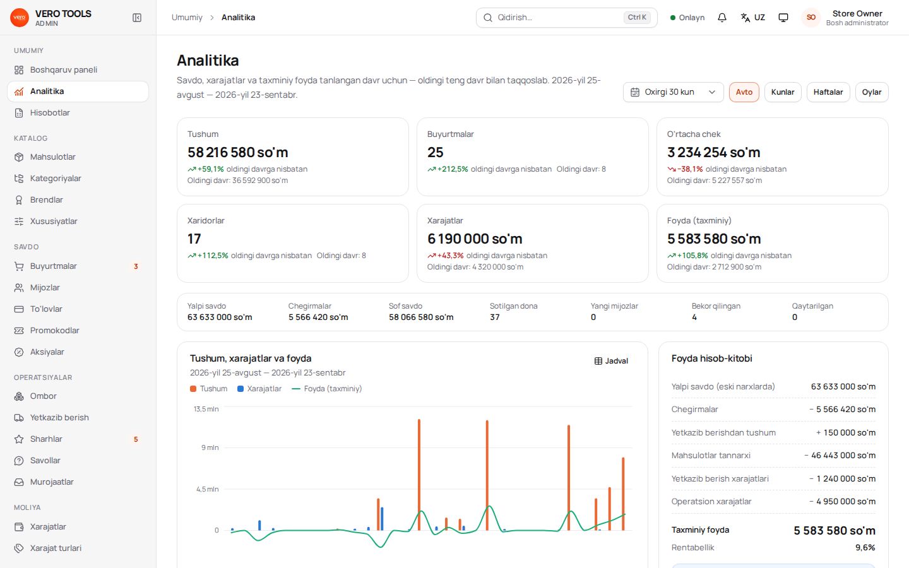
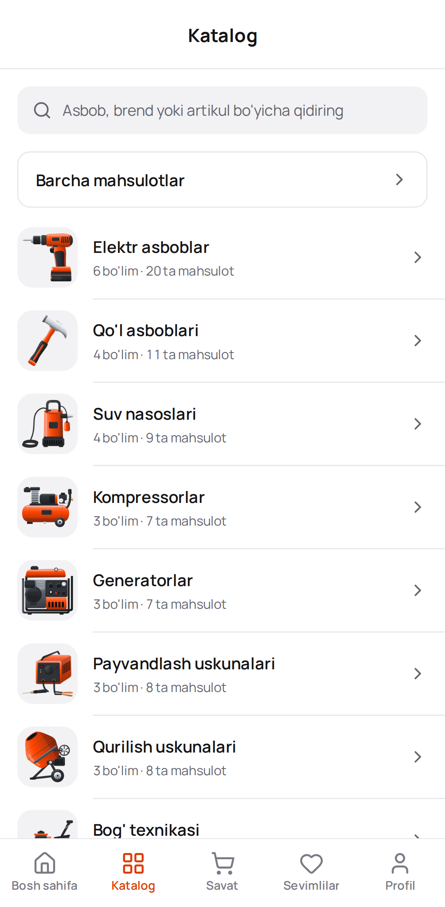

# OCKEAN TOOLS

E-commerce ecosystem for a professional tools and equipment store in Uzbekistan: **storefront**, **mobile app**
(Android / iOS), **admin panel** and **API** on one MongoDB database. A customer has one account on the website
and in the app; cart, wishlist, compare list, orders, addresses and notifications are synchronised between devices
in real time. Languages: Uzbek (default, Latin script), Russian, English. Currency: UZS.

## Qisqacha (o'zbekcha)

* **Tarkibi:** `apps/web` — internet-do'kon, `apps/mobile` — Android / iOS ilova (Expo), `apps/admin` — boshqaruv
  paneli, `apps/api` — server (Node.js, Express, MongoDB). Bitta ma'lumotlar bazasi, bitta hisob — sayt va ilovada
  bir xil; savat, sevimlilar, buyurtmalar real vaqtda sinxronlanadi.
* **Tez ishga tushirish (kompyuterda):** Node.js 22, MongoDB 7 kerak → `npm install` → `npm run seed -- --reset`
  (demo ma'lumotlar) → `npm run dev` → do'kon http://localhost:5173, admin panel http://localhost:5174
  (`admin@ockean.uz` / `OckeanAdmin2026`).
* **Serverga o'rnatish:** Docker Compose bilan — [docs/DEPLOYMENT.md](docs/DEPLOYMENT.md) (boshida o'zbekcha
  qisqacha yo'riqnoma bor). Haqiqiy do'konda faqat `--base` seed ishlatiladi, demo ma'lumotlar **hech qachon**.
* **To'lovlar:** naqd, karta (kuryer terminali), muddatli to'lov darhol ishlaydi. Payme, Click, Uzcard / Humo
  onlayn to'lovlari shartnoma va kalitlar `.env` ga kiritilgandan keyin yoqiladi — kalitsiz usul xaridorga
  ko'rsatilmaydi, to'lov faqat provayder tasdig'i bilan «to'langan» bo'ladi ([docs/PAYMENTS.md](docs/PAYMENTS.md)).
* **Ishga tushirishdan oldin** almashtirilishi kerak bo'lgan namunaviy ma'lumotlar ro'yxati quyida,
  «Before launch» bo'limida.

## What is inside

| Path | What | Stack |
|---|---|---|
| `apps/api` | REST API + Socket.IO, background jobs, seed | Node 22, Express 5, Mongoose 8, zod, JWT, sharp, Socket.IO |
| `apps/web` | Storefront (SEO server rendering of meta tags, sitemap, JSON-LD) | React 19, Vite 7, React Router 7, TanStack Query, Tailwind 4 |
| `apps/admin` | Admin panel | React 19, Vite 7, TanStack Table / Query, Tailwind 4, Recharts |
| `apps/mobile` | Customer app for Android and iOS | Expo SDK 57, React Native 0.86, React Navigation |
| `packages/*` | shared `types`, `validation` (zod), `api-client` (typed client + hooks + realtime), `ui`, `i18n`, `config` (brand tokens, regions, routes), `utils` | TypeScript source, no build step |
| `e2e` | Cross-device end-to-end checks | Playwright |
| `docs` | Architecture, API, deployment, payments, analytics, security, frontend guide | |

### Screenshots (demo data)

| Storefront | Admin panel | Mobile app |
|---|---|---|
|  |  |  |
|  |  |  |
|  |  |  |

More in [docs/screenshots](docs/screenshots) (dark theme, phone layout, cart, catalogue, orders, products,
inventory, roles).

### Features

* **Storefront:** mega menu, search with suggestions and history, catalogue with facets (brand, price, rating,
  availability, specifications), grid / list, compare, wishlist, cart with coupons and free-delivery progress,
  5-step checkout (details → delivery by region / pickup point → payment → review → done), order tracking with
  live status, account (profile, orders, addresses, notifications, reviews with photos, settings), content pages,
  FAQ, contacts; light / dark theme; `/ru` and `/en` URLs, hreflang sitemap, meta tags and JSON-LD per page.
* **Mobile app:** the same catalogue, cart, checkout, orders, wishlist, compare, reviews, notifications (push),
  profile and settings; deep links (`verotools://`, universal / app links); offline-tolerant session.
* **Admin panel:** dashboard computed from the database, orders (8 statuses: pending → confirmed → processing →
  packed → shipped → delivered, cancelled, returned; timeline, notes, printing, payments, installments),
  products with variants, specifications, media library (WebP sizes), inventory with a movement history,
  categories, brands, coupons, promotions, banners, delivery zones and pickup points, customers, reviews and
  questions, expenses, analytics (revenue, profit, trends), reports (CSV / XLSX / PDF), staff, roles and a
  permission matrix, notifications, translations, pages and FAQ, store settings, audit log.
* **API:** JWT access tokens + rotating refresh tokens with reuse detection, granular permissions checked on every
  admin route, rate limits, input validation with shared schemas, stock reservation that cannot oversell,
  domain events → e-mail / SMS / Telegram / push notifications, Payme and Click merchant protocols.

## Quick start (local development)

Requirements: **Node.js 22.12+** (`.nvmrc`), npm 10+, **MongoDB 7** on `127.0.0.1:27017` (a local `mongod`, or
the Compose services: `cp docker-compose.override.example.yml docker-compose.override.yml && docker compose up -d mongo redis`).
Redis is optional in development.

```bash
npm install
npm run seed -- --reset        # drops the database, then base data + fictional demo data (~2 minutes)
npm run dev                    # API :4000 · storefront :5173 · admin panel :5174
```

No `.env` is needed for local development: the defaults in `apps/api/src/config/env.ts` point to
`mongodb://127.0.0.1:27017/vero_tools` and use development-only JWT secrets (production refuses them). To change
something, create a small `.env` in the repository root, e.g.:

```dotenv
NODE_ENV=development
MONGO_URI=mongodb://127.0.0.1:27017/vero_tools?directConnection=true
# Expo web preview of the mobile app
CORS_ORIGINS=http://localhost:8081
```

`.env.example` documents every variable (it is written for production — `NODE_ENV=production`, Docker host names).

**Mobile app:** `cp apps/mobile/.env.example apps/mobile/.env`, set `EXPO_PUBLIC_API_URL` to
`http://<your computer's LAN IP>:4000/api`, then `npm run dev:mobile` and open it in Expo Go or a development
build (`w` opens the web preview). Details: [apps/mobile/README.md](apps/mobile/README.md).

### Accounts after the demo seed

| Role | Sign-in | Password |
|---|---|---|
| Owner (SUPER_ADMIN) | `admin@ockean.uz` or `+998900000001` | `OckeanAdmin2026` (development default) |
| Admin | `admin@example.com` | `Administrator2026` |
| Manager (orders, stock, reviews — no finance data) | `manager@example.com` | `Manager2026` |
| Customer | `+998901472536` (any phone in `apps/api/src/seed/data/customers.ts`) | `Demo2026` |

These passwords are public. They exist only in the demo data set and must never reach a real store.

### Seed: base vs demo

| Command | Loads |
|---|---|
| `npm run seed -- --base` · `seed:prod` · `docker compose --profile tools run --rm seed` | **Base data for a real store:** permissions and system roles, the owner account from `SEED_ADMIN_*`, store settings, delivery zones and pickup points, expense categories, pages and FAQ, specification definitions, category tree with illustrations. Idempotent — never overwrites what was changed in the admin panel. |
| `npm run seed` (development) · `npm run seed -- --reset` | Base data **plus demo data**: 15 fictional brands, 125 products with generated images and stock, promotions, coupons, banners, 24 customers, 72 orders placed through the real checkout and status workflow, reviews and questions, 12 months of expenses, search history. Production refuses demo data without `--demo --force`. |

All demo brands, products, people, reviews and figures are **fictional**; analytics and reports are always
computed from whatever is in the database — nothing is hard-coded.

## Commands

| Command | |
|---|---|
| `npm run dev` | API (tsx watch) + storefront + admin panel (Vite) |
| `npm run dev:api` · `dev:web` · `dev:admin` · `dev:mobile` | one app |
| `npm run build` | production builds of API (tsup), storefront and admin panel |
| `npm run start -w @vero/api` · `-w @vero/web` · `-w @vero/admin` | production servers (ports 4000 / 3000 / 3001) |
| `npm run typecheck` | TypeScript in every workspace |
| `npm test` | API integration tests (vitest, needs MongoDB: `MONGO_URI_TEST`, default `mongodb://127.0.0.1:27017`) |
| `npm run test:e2e` | Playwright checks against a running stack — see [e2e/README.md](e2e/README.md) |
| `node packages/i18n/scripts/check-keys.mjs` | uz / ru / en translation keys are identical |
| `npm run lint` · `npm run format` | ESLint (`eslint.config.mjs`) · Prettier |

## Production

Docker Compose runs MongoDB (single-node replica set, transactions), Redis, the API, the storefront server and the
admin server; nginx on the host terminates TLS. Step by step — server, `.env`, first start, base seed, nginx and
certificates, backups (`scripts/backup.sh`, `scripts/restore.sh`), upgrades, scaling, monitoring, mobile releases
with EAS and a security checklist — in **[docs/DEPLOYMENT.md](docs/DEPLOYMENT.md)**.

```bash
cp .env.example .env && chmod 600 .env      # fill in secrets, URLs, SEED_ADMIN_*, providers
docker compose up -d --build
docker compose --profile tools run --rm seed # base data + owner account (once)
```

CI (`.github/workflows/ci.yml`): translation keys, typecheck, API tests on MongoDB 7, production builds, Android
bundle export, end-to-end checks. `docker.yml` builds (and optionally pushes) the images for tags `v*`.

## Payments

| Method | Works out of the box | Needs |
|---|---|---|
| Cash, card on delivery (courier terminal) | yes | — (marked paid when the order is delivered) |
| Installment | yes | plans and minimum amount in Admin → Settings; a manager approves each application |
| Payme, Click | no | merchant contract, `PAYME_*` / `CLICK_*` in `.env`, callback URLs in the provider cabinet |
| Uzcard / Humo online, Visa / Mastercard | no | processed by Payme or Click (`CARD_PAYMENT_PROVIDER`, `BANK_CARD_PROVIDER`) |

A method whose provider is not configured is not offered to customers. Online payments become **paid only through
the provider's authenticated callback** — the admin panel cannot mark them paid by hand, and returning from the
payment page never changes a payment. Refunds are made in the provider cabinet and recorded in Admin → Payments.
Details and test procedures: [docs/PAYMENTS.md](docs/PAYMENTS.md).

## Before launch — replace the placeholders

The base seed contains realistic-looking **sample** values so the store works from the first start. Replace them:

* **Admin → Settings:** store and legal name, phones, e-mails, address, opening hours, map position, footer text,
  SEO texts, homepage advantages and trust bullets; add your social channels (they start empty).
* **Delivery:** zone prices, free-delivery thresholds and days; the sample pickup points (addresses, phones).
* **Pages & FAQ:** public offer / terms, privacy policy, returns, warranty, delivery and payment texts — have them
  reviewed by a lawyer.
* **`.env`:** JWT secrets, `SEED_ADMIN_*` (then remove the password), SMTP, Eskiz (SMS), Telegram bot, Expo token,
  Payme / Click keys, storage (local disk, S3 or Cloudinary), domains (`CLIENT_URL`, `ADMIN_URL`, `PUBLIC_API_URL`).
* **Mobile app:** `EAS_PROJECT_ID`, store listings, `IOS_APP_IDS` / `ANDROID_SHA256_FINGERPRINTS` for app links.
* **Catalogue:** your brands, products, prices, cost prices, stock, banners and promotions (never the demo data).

The domain `ockean.uz` is used as the default everywhere; change it in `.env` and in `apps/mobile` if yours differs.

## Documentation

| Document | |
|---|---|
| [docs/ARCHITECTURE.md](docs/ARCHITECTURE.md) | components, data model, order / stock / payment flows, realtime sync, jobs |
| [docs/API.md](docs/API.md) | every endpoint with permissions |
| [docs/FRONTEND_GUIDE.md](docs/FRONTEND_GUIDE.md) | how the apps use the API, i18n, design rules |
| [docs/DEPLOYMENT.md](docs/DEPLOYMENT.md) | production deployment and operations |
| [docs/PAYMENTS.md](docs/PAYMENTS.md) | Payme, Click, cards, installment, refunds |
| [docs/ANALYTICS.md](docs/ANALYTICS.md) | how revenue, profit and every dashboard figure are calculated |
| [docs/SECURITY.md](docs/SECURITY.md) | authentication, permissions, data protection, secrets |
| [apps/web](apps/web/README.md) · [apps/admin](apps/admin/README.md) · [apps/mobile](apps/mobile/README.md) | notes per app |

## Ground rules of this codebase

* No fake data in the UI: every number, list and status comes from the API; empty states come from empty responses.
* No fake actions: a button either calls the API or is not rendered; permissions are enforced by the API.
* No secrets in the repository: `.env` files are git- and docker-ignored; the example files contain placeholders only.
* Passwords are hashed with bcrypt; tokens are never logged. Uploads are checked by their content (magic bytes),
  images are re-encoded to WebP in three sizes, and files live on disk / S3 / Cloudinary — never inside MongoDB.
* The logo is used unchanged (1:1, `packages/config/brand`).
