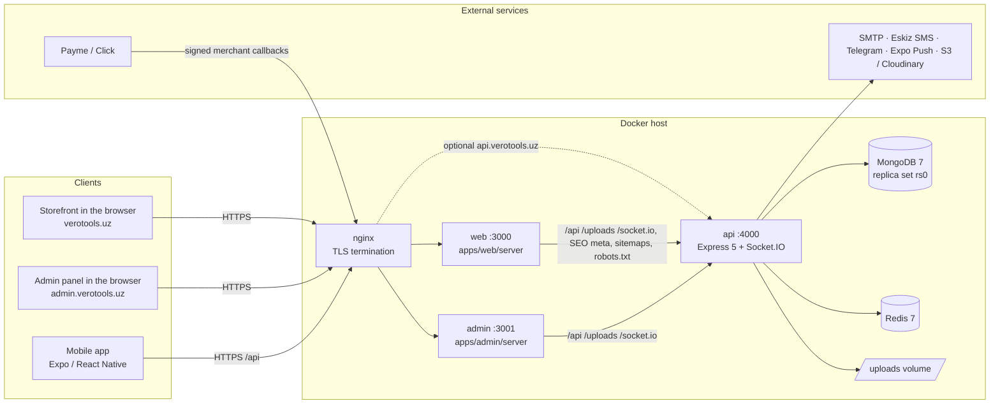

# VERO TOOLS — architecture

One API, one MongoDB database, three clients. A customer uses the same account on the storefront and in the
mobile app; staff work in the admin panel. Cart, wishlist, compare list, orders, addresses, notifications and
profile changes are pushed to every open client in real time.

Related documents: [DEPLOYMENT.md](DEPLOYMENT.md) (operations) · [SECURITY.md](SECURITY.md) ·
[PAYMENTS.md](PAYMENTS.md) · [ANALYTICS.md](ANALYTICS.md) · [API.md](API.md) (endpoint index) ·
[FRONTEND_GUIDE.md](FRONTEND_GUIDE.md) (client contract).

## 1. System overview

| Component | Technology | Role |
|---|---|---|
| `apps/api` | Node 22, Express 5, Mongoose 8, Socket.IO 4, zod 4, pino; bundled by tsup into `dist/index.js` + `dist/seed.js` | The only component with business logic and database access. REST API under `/api`, Socket.IO under `/socket.io`, crawler files at the root (`/robots.txt`, `/sitemap*.xml`), uploaded media under `/uploads` (local storage). |
| `apps/web` | React 19, Vite 7, React Router 7, TanStack Query, Tailwind 4; `server/index.mjs` (Express 5) | Storefront SPA. The Node server serves the build, injects SEO tags per URL and proxies `/api`, `/uploads`, `/socket.io`, sitemaps and `robots.txt` to the API, so the browser only ever talks to its own origin. |
| `apps/admin` | Same stack as web + TanStack Table / Virtual, Recharts; `server/index.mjs` | Admin panel SPA. The server adds a strict CSP and `X-Robots-Tag: noindex`, falls back to `index.html` for client routes and proxies `/api`, `/uploads`, `/socket.io`. |
| `apps/mobile` | Expo SDK 57, React Native 0.86, React Navigation 7 | Customer app, built with EAS. Calls the API with an absolute base URL (`EXPO_PUBLIC_API_URL`). |
| MongoDB 7 | single-node replica set `rs0` in Docker Compose | All data. Replica set ⇒ multi-document transactions. |
| Redis 7 | optional for one API instance, required for several | Shared cache, rate-limit counters, Socket.IO adapter, background-job locks. |

### Workspace packages (TypeScript source, no build step)

| Package | Contents |
|---|---|
| `packages/types` | DTOs returned by the API, enums (order / payment statuses, allowed transitions), permission keys and default role permissions, error codes. |
| `packages/validation` | zod schemas shared by API and forms; error messages are i18n keys. |
| `packages/api-client` | `createVeroApi()` typed client, TanStack Query hooks, realtime sync hook, token refresh. |
| `packages/ui` | Web design system (Tailwind 4 + Radix) for web and admin. |
| `packages/config` | Design tokens, brand assets, regions of Uzbekistan, `STORE_ROUTES` (URL map), constants and limits. |
| `packages/i18n` | i18next setup, shared namespaces, locale JSON files (`locales/{uz,ru,en}`), key checker. |
| `packages/utils` | Money, phone and date helpers (Asia/Tashkent), installment calculator, query-string helpers. |

The API bundle contains the workspace packages it uses (tsup `noExternal: [/^@vero\//]`); npm dependencies stay
external and are installed in the image. The web and admin bundles are self-contained static files.

## 2. Request flow

### Storefront page

1. nginx terminates TLS and forwards to the web server (`X-Forwarded-For` = client IP, `X-Forwarded-Proto`).
2. `/assets/*` (hashed Vite output) is served with `Cache-Control: immutable, max-age=1y`; other public files with a
   short cache.
3. Any other path is an SPA route: the server asks the API for `GET /api/seo/meta?path=<path>` (1.5 s timeout,
   60 s in-process cache, failures are not cached) and injects title, description, canonical, `hreflang`
   alternates, Open Graph / Twitter tags, JSON-LD, `robots` and `<html lang>` into `index.html`, answering with the
   status the API decided (404 for unknown products, categories …). If the API is slow or down the plain
   `index.html` is served with status 200. `/uz/...` is a permanent redirect to the unprefixed URL.
4. The SPA then calls `/api/...` on the same origin; the web server streams these requests (and WebSocket
   upgrades) to the API unchanged.

### API request pipeline (`apps/api/src/app.ts`)

`helmet` → CORS (`CLIENT_URL`, `ADMIN_URL`, `CORS_ORIGINS`; requests without `Origin` are allowed) → compression →
`/health`, `/ready` → `/uploads` static files (local storage) → pino-http request log → request context
(language from `?lang` / `Accept-Language`, client from `X-Client`, guest id from `X-Guest-Id`, client instance
from `X-Client-Instance`, client IP) → payment callbacks (`/api/payments/payme`, `/api/payments/click/*`, own body
parsers and response formats) → JSON (2 MB) / urlencoded (200 KB) parsers, cookies, NoSQL-operator stripping →
`/api` router: global rate limit, optional bearer authentication, module routers (zod validation → service →
MongoDB) → crawler routes → 404 → error handler.

Responses use `{ "data": … }` (lists add `"meta": { page, limit, total, pages }`); errors are
`{ "error": { code, message, fields?, details? } }` with codes from `packages/types/src/errors.ts`.

### Mobile request

The app calls `https://verotools.uz/api` (or `https://api.verotools.uz/api`) directly with `X-Client: mobile`
and `Authorization: Bearer <access token>`; images come as absolute URLs built from `PUBLIC_API_URL`.

### Payment callback

Payme / Click call `PUBLIC_API_URL/api/payments/...` from their servers. The request passes nginx (and the web
server when `PUBLIC_API_URL` is the storefront origin), is authenticated by the provider's signature and never by
a session. See [PAYMENTS.md](PAYMENTS.md).

## 3. Authentication and sessions

| | Access token | Refresh token |
|---|---|---|
| Format | JWT HS256, signed with `JWT_SECRET`, issuer `vero-tools-api`, claims `sub`, `role`, `tv` (token version) | JWT HS256, signed with `JWT_REFRESH_SECRET`, claims `sub`, `jti`, `fam` (session family) |
| Lifetime | `JWT_ACCESS_TTL` (15 min) | `JWT_REFRESH_TTL_DAYS` (30 days) |
| Storage — web / admin | memory only (never `localStorage`) | httpOnly cookie `vt_rt` (storefront) / `vt_art` (admin), `Path=/api/auth`, `SameSite=Lax`, `Secure` (`COOKIE_SECURE=true`), host-only |
| Storage — mobile | memory | `expo-secure-store`; sent in the request body |
| Server state | none; every request loads the user and compares `tv` with `user.tokenVersion` | SHA-256 hash in the `refreshtokens` collection (`user`, `family`, `client`, `ip`, `userAgent`, `expiresAt` with a TTL index) |

* **Rotation.** `POST /api/auth/refresh` verifies the token, checks the stored hash, issues a new pair in the same
  family and revokes the old record (`replacedBy`). The revocation is a conditional update, so two concurrent
  refreshes of one token cannot both succeed.
* **Reuse detection.** Presenting an already rotated refresh token revokes every token of its family (theft is
  assumed) and ends that session on all devices.
* **Token versioning.** Password change, password reset, blocking an account or changing a staff member's role
  revokes all refresh tokens and increments `user.tokenVersion`; outstanding access tokens stop working
  immediately because every request compares `tv`.
* **Logout** revokes the presented refresh token and clears the cookie.
* **Staff sign-in.** A login from the admin client (`X-Client: admin`) is refused for customers without
  permissions. `/api/admin/*` additionally requires a staff role and checks a granular permission per route.
* Clients refresh transparently on `401 TOKEN_EXPIRED` (`packages/api-client`). A guest without a session gets
  `204` from `/api/auth/refresh` (not an error).

Password hashing, rate limits and OTP handling: [SECURITY.md](SECURITY.md).

## 4. Realtime synchronisation (Socket.IO)

* Path `/socket.io`; the web and admin servers proxy the WebSocket upgrade. Clients connect WebSocket-first with
  long-polling as fallback.
* Handshake `auth`: `{ token }` (access token) → room `user:<id>`; `{ token, admin: true }` from a staff member
  with `orders.read` → additionally room `admin`; `{ guestId }` (UUID) → room `guest:<uuid>`. Invalid tokens are
  rejected; blocked users or a changed token version cannot connect.
* Events (`SOCKET_EVENTS` in `packages/config`): `sync` `{ entity, id?, origin? }` for `cart`, `wishlist`,
  `compare`, `orders`, `notifications`, `profile`, `addresses`, `reviews` — clients invalidate the matching
  queries and refetch; `notification:new`, `order:updated`; staff: `admin:order:new`, `admin:order:updated`,
  `admin:stock:low`, `admin:review:new`.
* **Echo suppression.** Every client instance sends a random `X-Client-Instance` id with its requests; the API
  copies it into `origin` of the resulting `sync` event and the originating tab/device ignores its own echo while
  the user's other devices refetch.
* **Several API instances.** With `REDIS_URL` the Redis adapter (`@socket.io/redis-adapter`) fans events out to
  sockets connected to any instance. Without Redis, events reach only sockets of the emitting instance.

## 5. Guest sessions and merge on sign-in

* Anonymous visitors get a UUID v4 (`X-Guest-Id`, persisted per device). Cart, wishlist and compare list belong to
  either the signed-in user or that guest id; guest documents expire 60 days after the last change (TTL index).
* Checkout requires an account (orders always belong to a user).
* On login / registration from the storefront or the app, the guest cart, wishlist and compare list are merged
  into the account (quantities added and capped at the available stock, cart line limit 60) and the guest
  documents are deleted; the admin client never merges. A failing merge never blocks the sign-in.

## 6. Pricing and promotions

* Products (and variants) have a **regular price** and an optional regular "old" price. The effective `price` /
  `oldPrice` / `discountPercent` fields are denormalised on the product so listings, search and facets need no
  computation.
* **Promotions** (period, targets: products, categories incl. sub-categories, brands; percent or fixed amount;
  priority). The best promotion for a product is the highest priority, then the lowest resulting price. Percent
  discounts are capped at 90 % and rounded down to whole 100 so'm. With variants the product shows its cheapest
  active variant.
* The job `promotions.refresh-pricing` recomputes prices every minute but only writes when the set of active
  promotions changed (start / end / edit); product edits re-price immediately. Price drops of published products
  emit `product.price_dropped` (wishlist notifications).
* **Coupons** are applied at cart / checkout: scope all / products / categories / brands, percent (optional cap) or
  fixed, minimum order amount, total and per-customer usage limits, first-order-only, validity window. The
  discount is allocated proportionally over the eligible lines; usage is consumed atomically when the order is
  created and released if the order is cancelled.
* **Delivery fee** comes from the delivery zone of the region (price, free-delivery threshold, delivery days);
  pickup points are free.
* **Order totals** are snapshots: `regularSubtotal` (pre-promotion), `subtotal` (after promotions),
  `promotionDiscount`, `couponDiscount`, `deliveryFee`, `total`, `costTotal` (cost price × quantity at order time).
  Later price changes never alter existing orders.

## 7. Inventory — reservation, never oversell

Each product (or variant) has an `inventories` record: `onHand`, `reserved`, `incoming`, `minStock`, `costPrice`;
available = `onHand − reserved`. Every change writes an `inventorymovements` row (type, quantity, before/after,
reference, user, reason).

| Event | Movement | Effect |
|---|---|---|
| Order placed | `RESERVE` | `reserved += qty` — one atomic conditional update per SKU that only matches when `onHand − reserved ≥ qty`, so concurrent checkouts can never oversell. If any line fails, the lines already reserved by this order are released and the checkout answers `409 INSUFFICIENT_STOCK`. |
| Order `SHIPPED`, or `DELIVERED` straight from `PACKED` | `OUT` | `onHand −= qty`, `reserved −= qty` (stock leaves the warehouse) |
| Order `CANCELLED` before shipping | `RELEASE` | `reserved −= qty` |
| Order `RETURNED` | `RETURN` | `onHand += qty` |
| Admin: receive / adjust / stock count / expected | `IN` / `ADJUSTMENT` / set / `INCOMING` | reason required; on-hand can never drop below reserved |

The order keeps `inventoryState` (`reserved → deducted | released → returned`), so every transition applies its
stock effect exactly once. On a replica set the order, payment, reservation and coupon usage are written in one
transaction (retried on transient write conflicts); on a standalone server compensating updates keep the same
guarantees. Low stock (≤ max(`inventory.lowStockThreshold`, `minStock`)) notifies staff (Socket.IO + Telegram).

## 8. Order state machine

Allowed transitions — `ORDER_STATUS_TRANSITIONS` in `packages/types/src/enums.ts`, enforced by the API (the admin
UI reads the same table):

| From \ To | CONFIRMED | PROCESSING | PACKED | SHIPPED | DELIVERED | CANCELLED | RETURNED |
|---|:-:|:-:|:-:|:-:|:-:|:-:|:-:|
| **PENDING** | ✓ | | | | | ✓ | |
| **CONFIRMED** | | ✓ | | | | ✓ | |
| **PROCESSING** | | | ✓ | | | ✓ | |
| **PACKED** | | | | ✓ | ✓ | ✓ | |
| **SHIPPED** | | | | | ✓ | | ✓ |
| **DELIVERED** | | | | | | | ✓ |
| **CANCELLED** | final | | | | | | |
| **RETURNED** | final | | | | | | |

* Customers may cancel their own order only while it is `PENDING` or `CONFIRMED`; every other change is made by
  staff with `orders.update` (or by the system).
* Status updates are optimistic: the transition is claimed first with a `findOneAndUpdate` on the expected
  current status, and only the caller that wins the claim moves stock — so a double click, a provider callback
  racing a staff action or two admins can never release or deduct stock twice (on a standalone server a failed
  stock movement restores the previous status). A caller that finds the order already in the requested status
  gets it back unchanged; any other concurrent edit answers `409 CONFLICT`. Every change is appended to
  `statusHistory` (who, when, note) and audited.
* System transitions: a received online payment moves `PENDING → CONFIRMED`; a cancelled online payment cancels a
  `PENDING` order; a provider refund of an order that has not shipped cancels it; unpaid online orders are
  cancelled after `order.autoCancelUnpaidMinutes` (Admin → Settings, default 30); installment approval /
  rejection confirms / cancels.
* Payment side effects (`onOrderStatus`): cancelling or returning a `PAID` order sets the payment to
  `REFUND_PENDING` (the refund itself is made in the provider cabinet, see PAYMENTS.md); cancelling an unpaid
  order cancels its pending payment; `DELIVERED` marks cash / card-on-delivery payments as paid.
* `DELIVERED` adds the order total to the customer's lifetime spend (subtracted again on `RETURNED`) and the
  quantities to the product sales / popularity counters.
* Order numbers: `VT-YYMMDD-NNN` (Tashkent business date + daily counter).

## 9. Media pipeline

1. Upload limits (multer, in memory): images 10 MB × 20 files per request (media library), expense attachments
   15 MB × 10, review photos 5 MB × 5, avatar 3 MB.
2. The real type is detected from the **magic bytes** — the client's MIME type and file name are ignored. Accepted:
   JPEG, PNG, WebP, GIF, AVIF (+ PDF for expense attachments only). SVG is rejected (can carry scripts).
3. **sharp** decodes (max 60 megapixels, damaged files → `415`), auto-rotates by EXIF, strips metadata and writes
   **WebP in three sizes**: 1600 px (main), 800 px (medium), 360 px (thumbnail).
4. The storage driver stores the files under `<folder>/<YYYY>/<MM>/<media id>[-800|-360].webp`:
   * `local` — `UPLOAD_DIR` (Docker: `/data/uploads`, volume `uploads`), served by the API at `/uploads/...` with
     a one-year immutable cache. URLs are stored relative and returned absolute via `PUBLIC_API_URL`.
   * `s3` — any S3-compatible bucket; public URL from `S3_PUBLIC_URL` / the endpoint.
   * `cloudinary` — `CLOUDINARY_URL`.
5. A `media` document keeps provider, key, URLs, dimensions, alt texts (uz/ru/en), tags and uploader; products,
   categories, brands, banners and promotions embed the URLs. Deleting media that is still referenced is refused
   (`409 IN_USE`) unless the deletion is explicitly forced.

The storefront CSP allows images from any `https:` origin; the admin panel rewrites `/uploads/...` URLs to its own
origin and needs `ASSET_ORIGINS` for S3 / Cloudinary hosts.

## 10. Caching

| Layer | What | TTL / invalidation |
|---|---|---|
| API cache (`lib/cache.ts`): Redis (`vt:` prefix) with `REDIS_URL`, otherwise an in-process map (≤ 2000 keys) | settings (120 s), SEO meta (120 s), public translations (300 s), home page blocks, delivery zones, content | tag prefixes (`catalog:`, `home:`, `settings:`, `content:`, `translations:`) are invalidated by admin writes |
| API in-process | catalogue index for search and facets (categories, brands, specifications); role → permissions | 60 s, plus explicit invalidation on the instance that made the change |
| Storefront server | SEO meta per path | 60 s, max 2000 paths |
| HTTP | hashed assets (1 year, immutable), `/uploads` (1 year, immutable), sitemaps (15 min), `robots.txt` (1 h); API responses with personal data are `no-store` | — |

Without Redis, cache invalidation reaches only the local process — one reason several API instances need Redis.

## 11. Internationalisation (uz · ru · en)

* Languages: Uzbek (default, Latin script), Russian, English. Storefront URLs: Uzbek unprefixed (`/catalog`),
  others prefixed (`/ru/catalog`, `/en/catalog`); `/uz/...` redirects to the unprefixed URL.
* Catalogue content (names, descriptions, SEO fields, pages, FAQ, banners …) is stored per language
  (`{ uz, ru, en }`) and returned localised according to `Accept-Language` / `?lang=`.
* UI texts live in `packages/i18n/locales/{uz,ru,en}/*.json`: shared namespaces `common`, `shop`, `validation`,
  `errors` plus `web`, `admin`, `mobile`. `node packages/i18n/scripts/check-keys.mjs` (CI) verifies that all
  three languages have identical keys.
* **Admin overrides**: Admin → Translations lists every key of every namespace (read from the locale files,
  `I18N_LOCALES_DIR`) and stores edited values in MongoDB. Clients load `GET /api/translations?lng=` after start and
  apply the overrides over the bundled texts.
* API error and validation messages are i18n keys; e-mails, SMS and push texts are rendered in the user's language.

## 12. SEO

* Per-URL meta (see §2) for home, catalogue, categories, products, brands, promotions, content pages and FAQ, with
  JSON-LD (`WebSite` + `SearchAction`, `Organization`, `Product` + `Offer` + `AggregateRating` + `Brand`,
  `BreadcrumbList`, `FAQPage`); unknown slugs answer 404. Account, cart, checkout, compare, wishlist,
  search and auth pages are `noindex` (`NOINDEX_PREFIXES`).
* `/sitemap.xml` lists every active category, brand, promotion, content page and published product in all three
  languages, each `<url>` with `xhtml:link` `hreflang` alternates (uz, ru, en, x-default); above 15 000 entries it
  becomes a sitemap index of `/sitemap-N.xml` files.
* `/robots.txt` allows indexing only when `NODE_ENV=production` **and** `SEO_INDEXING=true` (set `false` on
  staging), disallows the noindex prefixes in every language and points to the sitemap.
* Canonical and alternate URLs are built from `CLIENT_URL`.

## 13. Background jobs, domain events and notifications

Jobs run inside the API process when `JOBS_ENABLED=true` (`apps/api/src/jobs/scheduler.ts`). With Redis each job
takes a short lock per run (`SET NX PX`), so only one of several instances executes it.

| Job | Interval | Purpose |
|---|---|---|
| `promotions.refresh-pricing` | 1 min | Apply promotions that started or ended (no-op when nothing changed). |
| `orders.expire-unpaid` | 5 min | Cancel online-payment orders unpaid after `order.autoCancelUnpaidMinutes` and release their stock (a Payme transaction in progress is left alone for 12 h). |
| `search.prune-log` | 24 h | Delete search analytics older than one year. |

Domain events (`lib/events.ts`, in-process) decouple side effects: `order.created`, `order.status_changed`,
`payment.paid`, `payment.failed`, `product.price_dropped`, `product.back_in_stock`, `inventory.low_stock`,
`review.*`, `question.answered`, `contact.created`, `user.registered`. Notification handlers deliver:

* customers — in-app notification + Expo push; e-mail for confirmed / shipped / delivered / cancelled orders and SMS
  for shipped / delivered (switches in Admin → Settings); per-user channel preferences are respected;
* staff — Socket.IO events in the admin panel and Telegram messages (new orders, low stock, contact messages).

## 14. Data model (MongoDB collections)

`users`, `roles`, `permissions`, `refreshtokens`, `verificationcodes`, `addresses`, `categories`, `brands`,
`productspecifications`, `products`, `inventories`, `inventorymovements`, `carts`, `wishlists` / compare lists,
`orders`, `counters`, `payments`, `promotions`, `coupons`, `banners`, `media`, `reviews`, questions,
`notifications`, `pages`, `faqs`, `settings`, `translations`, `deliveryzones`, `pickuppoints`, `expenses`,
`expensecategories`, contact messages, search queries, `auditlogs`. Schemas: `apps/api/src/models`. Indexes are
created automatically on start (`autoIndex`) and by the seed.
