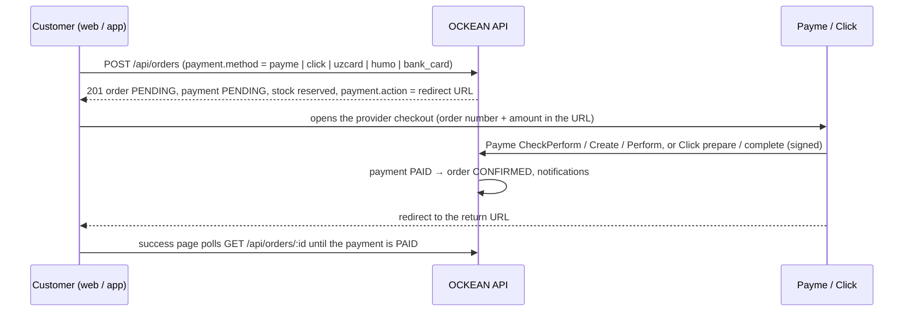

# OCKEAN — payments

> **No payment credentials are included in this repository.** Merchant ids, keys and secret keys come from the
> Payme and Click merchant cabinets and are set only in the server's `.env` (`PAYME_*`, `CLICK_*`). The values in
> `apps/api/tests/setup.ts` are dummy test strings used by the automated protocol tests and work nowhere else.

Sources: `apps/api/src/modules/payments/` (`payments.service.ts`, `payme.routes.ts`, `click.routes.ts`), order
integration in `apps/api/src/modules/orders/orders.service.ts`, admin endpoints in
`apps/api/src/modules/admin/orders.admin.ts` and `operations.admin.ts`, tests in `apps/api/tests/payments.test.ts`.

## 1. Payment methods

| Code | Shown to customers as | Provider | Online | Payment becomes `PAID` when |
|---|---|---|:-:|---|
| `cash` | Naqd pul / Наличными / Cash | cash | — | the order is set to `DELIVERED` (collected by the courier / at the pickup point) |
| `card_on_delivery` | Karta orqali qabul qilganda / Card on delivery | cash | — | the order is set to `DELIVERED` (courier's card terminal) |
| `payme` | Payme | Payme | ✓ | Payme calls `PerformTransaction` (authenticated with the merchant key) |
| `click` | Click | Click | ✓ | Click calls `complete` (valid MD5 signature) |
| `uzcard`, `humo` | Uzcard, Humo | `CARD_PAYMENT_PROVIDER` (`payme` default, or `click`) | ✓ | that provider's callback |
| `bank_card` | Visa / Mastercard | `BANK_CARD_PROVIDER` (`payme` / `click`; empty = method disabled) | ✓ | that provider's callback |
| `installment` | Muddatli to'lov / Рассрочка / Installment | installment | — | never automatically — the application is reviewed by staff (§6) |

A method is offered at checkout (`GET /api/payments/methods?amount=`) only when

1. it is enabled in **Admin → Settings → payments** (`payments.enabledMethods`, all methods by default),
2. its provider is configured — Payme: `PAYME_MERCHANT_ID` + `PAYME_KEY`; Click: `CLICK_SERVICE_ID` +
   `CLICK_MERCHANT_ID` + `CLICK_SECRET_KEY`; installment: `INSTALLMENT_ENABLED=true` **and** the installment setting
   enabled; `bank_card`: `BANK_CARD_PROVIDER` set,
3. for installment: the order total reaches the minimum amount (below it the method is listed as unavailable with
   reason `MIN_AMOUNT`).

`POST /api/orders` re-checks the method (`422 PAYMENT_METHOD_UNAVAILABLE`), so an unconfigured provider can never be
selected. The provider is resolved when the order is placed and stored on the order; changing
`CARD_PAYMENT_PROVIDER` later affects new orders only.

**The API never marks a payment as paid on its own without a correctly authenticated provider callback** (or, for
cash / card on delivery, the `DELIVERED` status set by staff). For offline methods the only other path is an
explicit, audited action of a staff member (see [Manual payment changes by staff](#manual-payment-changes-by-staff));
online payments cannot be marked paid by hand at all. Redirecting back from the provider, opening the success page
or polling never changes a payment.

## 2. Online payment flow



* **Return URL:** web `CLIENT_URL/checkout/success/<order id>?payment=return`, app
  `MOBILE_RETURN_URL/<order id>` (`verotools://orders/<id>`).
* **Unpaid orders:** online orders still `PENDING` / unpaid after `order.autoCancelUnpaidMinutes`
  (Admin → Settings, default 30 minutes) are cancelled by a background job every 5 minutes and their stock is
  released. A Payme transaction that was created but not yet performed is left alone for its 12-hour lifetime.
  Cash, card-on-delivery and installment orders are never auto-cancelled.
* **Callback URLs** must be reachable over HTTPS from the providers: `PUBLIC_API_URL/api/payments/...` (the admin
  panel shows the exact URLs under Payments → providers). They pass through nginx (and the web server when
  `PUBLIC_API_URL` is the storefront origin); they are exempt from the API rate limiter and authenticated only by
  the provider's key or signature.

## 3. Payme (Paycom) — Merchant API

Setup in the Payme merchant cabinet (business account, "Cashbox" / kassa settings):

| Cabinet setting | Value |
|---|---|
| Endpoint URL | `https://ockean.uz/api/payments/payme` (or `https://api.ockean.uz/api/payments/payme`) |
| Account field | `order_id` — the OCKEAN order number, e.g. `VT-261001-007` |
| Merchant (cashbox) id | → `PAYME_MERCHANT_ID` |
| Key | test key while testing, production key afterwards → `PAYME_KEY` |

```dotenv
PAYME_MERCHANT_ID=<cashbox id from the cabinet>
PAYME_KEY=<test key, later the production key>
PAYME_TEST_MODE=true          # customers go to checkout.test.paycom.uz; false → checkout.paycom.uz
```

Apply changes with `docker compose up -d api`. The checkout redirect is
`https://checkout.paycom.uz/<base64("m=<merchant id>;ac.order_id=<order number>;a=<amount in tiyin>;c=<return url>;l=<uz|ru|en>")>`.

**What the endpoint implements** (`POST /api/payments/payme`, JSON-RPC 2.0, always HTTP 200):

* Authentication: `Authorization: Basic base64("Paycom:" + PAYME_KEY)`, compared in constant time; anything else
  (also while Payme is not configured) → `-32504`. Malformed JSON → `-32700` (only for authenticated calls).
* Amounts are in **tiyin** (1 so'm = 100 tiyin) and must equal the order total × 100 exactly.

| Method | Behaviour |
|---|---|
| `CheckPerformTransaction` | Order exists, uses Payme, order `PENDING` with a pending payment, exact amount → `{ allow: true }` |
| `CreateTransaction` | Idempotent per Payme transaction id (a retry returns the same transaction). Only one active transaction per order (`-31099` while another one is pending). A transaction older than 12 h is cancelled (reason 4) → `-31008`. |
| `PerformTransaction` | Idempotent. Marks the payment `PAID` (the order moves `PENDING → CONFIRMED`, the customer is notified). Refused for cancelled orders or expired transactions (`-31008`). |
| `CancelTransaction` | Created (state 1) → cancelled (state −1), the payment is cancelled and a pending order is cancelled (stock released). Performed (state 2) → refunded (state −2): payment `REFUNDED`; an order that has not shipped yet is cancelled. Refused with `-31007` once the order is `SHIPPED` or `DELIVERED` (handle it as a return). |
| `CheckTransaction` | Current state with create / perform / cancel times and the cancel reason. |
| `GetStatement` | All Payme transactions created in `[from, to]` (reconciliation). |
| `ChangePassword` | Refused (`-32504`): the key is changed in `.env` + API restart, never over the API. |

| Code | Meaning |
|---|---|
| `-32504` | insufficient privileges (wrong / missing key) |
| `-32700` | parse error (malformed JSON) |
| `-32600` | invalid request (no method / params, no transaction id) |
| `-32601` | unknown method |
| `-31001` | incorrect amount (`data: "amount"`) |
| `-31050` | order not found (`data: "order_id"`) |
| `-31051` | order cannot be paid (not a Payme order, not pending, or already handled) |
| `-31099` | another transaction is pending for this order |
| `-31003` | transaction not found |
| `-31008` | operation cannot be performed (cancelled order, expired or cancelled transaction, internal error) |
| `-31007` | transaction cannot be cancelled (goods already shipped / delivered) |

**Testing with the Payme sandbox:** keep `PAYME_TEST_MODE=true` with the **test key**, register the endpoint URL in
the sandbox (test.paycom.uz) and run its scenario checks — it calls every method with valid and invalid data
(wrong key, unknown order, wrong amount, repeated calls, cancellations). Then place a real order on the storefront
with a Payme test card. A quick manual check of the endpoint:

```bash
curl -s https://ockean.uz/api/payments/payme \
  -u "Paycom:$PAYME_KEY" -H 'Content-Type: application/json' \
  -d '{"jsonrpc":"2.0","id":1,"method":"CheckPerformTransaction","params":{"amount":100,"account":{"order_id":"VT-000000-000"}}}'
# → {"jsonrpc":"2.0","id":1,"error":{"code":-31050,...,"data":"order_id"}}   (authenticated, order unknown)
```

**Going live:** put the production key into `PAYME_KEY`, set `PAYME_TEST_MODE=false`,
`docker compose up -d api`, pay one small real order and refund it through the cabinet.

## 4. Click — SHOP-API (Prepare / Complete)

Setup in the Click merchant cabinet (service settings):

| Cabinet setting | Value |
|---|---|
| Prepare URL | `https://ockean.uz/api/payments/click/prepare` |
| Complete URL | `https://ockean.uz/api/payments/click/complete` |
| Service id, merchant id, merchant user id, secret key | → `CLICK_SERVICE_ID`, `CLICK_MERCHANT_ID`, `CLICK_MERCHANT_USER_ID` (optional), `CLICK_SECRET_KEY` |

The checkout redirect is `https://my.click.uz/services/pay?service_id=…&merchant_id=…&amount=<so'm, 2 decimals>&
transaction_param=<order number>&return_url=…` (plus `merchant_user_id`, and `card_type=uzcard|humo` for the Uzcard /
Humo methods). `merchant_trans_id` in the callbacks is the order number.

**Requests** are `application/x-www-form-urlencoded` (JSON is accepted too) with `click_trans_id`, `service_id`,
`click_paydoc_id`, `merchant_trans_id`, `amount` (so'm), `action` (`0` prepare, `1` complete), `error`,
`error_note`, `sign_time`, `sign_string`; complete also carries `merchant_prepare_id`.

**Signature** (MD5, lowercase hex, compared in constant time):

```text
prepare:   md5(click_trans_id + service_id + CLICK_SECRET_KEY + merchant_trans_id + amount + action + sign_time)
complete:  md5(click_trans_id + service_id + CLICK_SECRET_KEY + merchant_trans_id + merchant_prepare_id + amount + action + sign_time)
```

* **prepare** — checks the service id, signature and action; the order must exist and use Click, must not be paid
  (`-4`) or cancelled (`-9`), and the amount must equal the order total (±0.01). Stores `click_trans_id` and answers
  with a new `merchant_prepare_id`.
* **complete** — checks signature and action; the Click transaction and `merchant_prepare_id` must match a prepared
  payment (`-6`). An `error` < 0 sent by Click cancels the payment (a pending order is cancelled, stock released)
  and is answered with `-9`. Otherwise the amount is re-checked and the payment is marked `PAID` (order
  `CONFIRMED`); the answer carries `merchant_confirm_id`. Replays of a completed payment get `-4` and never pay twice.

Response: `{ click_trans_id, merchant_trans_id, merchant_prepare_id | merchant_confirm_id, error, error_note }`.

| `error` | Meaning |
|---|---|
| `0` | success |
| `-1` | SIGN CHECK FAILED |
| `-2` | incorrect amount |
| `-3` | action not found |
| `-4` | already paid |
| `-5` | order not found (Click's "user does not exist") |
| `-6` | transaction does not exist / prepare id mismatch |
| `-7` | failed to update (internal error — logged) |
| `-8` | error in request from Click (Click not configured or wrong `service_id`) |
| `-9` | transaction cancelled (order or payment cancelled) |

**Testing:** use the test tools / test service Click provides to merchants (ask Click technical support) against a
staging server, then pay a small real order. To exercise a deployed endpoint by hand, compute the signature
yourself:

```bash
SECRET='<CLICK_SECRET_KEY>'; SID='<CLICK_SERVICE_ID>'; ORDER='VT-261001-007'; AMOUNT='250000'; T='2026-10-01 12:00:00'
SIGN=$(printf '%s' "12345${SID}${SECRET}${ORDER}${AMOUNT}0${T}" | md5sum | cut -d' ' -f1)
curl -s https://ockean.uz/api/payments/click/prepare \
  --data-urlencode click_trans_id=12345 --data-urlencode service_id="$SID" --data-urlencode click_paydoc_id=1 \
  --data-urlencode merchant_trans_id="$ORDER" --data-urlencode amount="$AMOUNT" --data-urlencode action=0 \
  --data-urlencode error=0 --data-urlencode sign_time="$T" --data-urlencode sign_string="$SIGN"
```

Use a staging database for such tests: a successful `complete` marks the order paid.

## 5. Card routing

| Customer chooses | Provider | Configure |
|---|---|---|
| Uzcard / Humo | `CARD_PAYMENT_PROVIDER` — `payme` (default) or `click` | the chosen provider must be configured; with Click the checkout opens the requested card type |
| Visa / Mastercard (`bank_card`) | `BANK_CARD_PROVIDER` — `payme` / `click` | leave empty (method hidden) unless your contract with that provider covers international cards |
| Payme / Click | fixed | — |

## 6. Cash and card on delivery

* The order is created `PENDING` with a pending payment (provider `cash`); stock is reserved immediately.
* Staff confirm the order and move it through `PROCESSING → PACKED → SHIPPED → DELIVERED` (or `PACKED → DELIVERED`
  for pickup). Setting `DELIVERED` records the payment as `PAID` ("collected on delivery") and notifies the
  customer. The courier / pickup point must actually have collected the money before the status is set.
* Cancelling before delivery cancels the pending payment and releases the stock.
* In analytics the order counts as revenue from `CONFIRMED` on (revenue follows the order status, see
  [ANALYTICS.md](ANALYTICS.md)).

## 7. Installment

* Available when `INSTALLMENT_ENABLED=true`, the installment setting is enabled in Admin → Settings and the order
  total reaches the minimum (default 1 000 000 so'm). Plans (months + markup %) are edited in Admin → Settings —
  defaults 3 months / 0 %, 6 months / 7 %, 12 months / 15 %.
* Calculation: `total = round(order total × (1 + markup / 100))`, `monthly = total / months` rounded up to
  1 000 so'm. Both are stored on the order.
* The order is created `PENDING`; the payment stays pending and the application is `UNDER_REVIEW`. The customer sees
  "application received — a manager will contact you".
* A manager (permission `orders.update`) reviews it on the order page: **Approve** confirms the order,
  **Reject** cancels it (stock released). Both decisions are audited.
* The installment contract and the collection of the instalments happen outside the system (store contract or
  partner). When the money has been received, record it as a manual payment (below) so the payment status is
  correct.

## 8. Refunds

* Cancelling or returning an order whose payment is `PAID` sets the payment to `REFUND_PENDING` (refund status
  `PENDING`, refund amount = paid amount). **No money is sent back automatically.**
* Make the refund where the money was taken — the Payme / Click merchant cabinet, or in cash — then record it in
  **Admin → Payments**: refund status `REFUNDED` (optionally a smaller amount for a partial refund and a note) or
  `REJECTED`. `REFUNDED` sets the payment and the order's payment status to `REFUNDED`. Every change is audited
  (`payment.refund_update`).
* Payme reports cancellations of performed transactions itself (`CancelTransaction`): the payment becomes
  `REFUNDED` automatically and an order that has not shipped is cancelled; after shipping Payme's cancellation is
  refused (`-31007`) and the case is handled as a return.
* Click SHOP-API has no refund callback: refunds made in the Click cabinet must be recorded in Admin → Payments.

### Manual payment changes by staff

`PATCH /api/admin/orders/:id/payment` (order page in the admin panel) lets staff with **both** `orders.update` and
`payments.update` set a payment to `PAID`, `FAILED`, `CANCELLED` or `REFUNDED` — for cash / card collected outside
the courier flow, bank transfers, installment payments received and reconciliation.

* **Online payments (Payme, Click — including Uzcard / Humo / Visa / Mastercard processed by them) can never be
  marked `PAID` by hand.** The request is refused with `409 CONFLICT`; only the provider's authenticated callback
  confirms them. If a customer paid but the callback did not arrive, check the transaction in the provider cabinet
  and let the provider re-send it (Payme `CheckTransaction` / `PerformTransaction`, Click `complete`).
* `FAILED` records a declined / unsuccessful payment, `CANCELLED` a payment that will not be made. Either one on a
  pending **online** order also cancels the order and releases its stock.
* Marking `PAID` (offline methods only) confirms a pending order.

Each change is written to the payment history with the staff member's name and to the audit log
(`order.payment_update`, old and new status).

By default ADMIN and SUPER_ADMIN have both permissions, MANAGER does not. Grant `payments.update` only to people
who reconcile payments, and review the audit log (Admin → Audit log, filter `order.payment_update`) regularly.

## 9. Operations and security notes

* Keys live only in `.env` (mode 600) and in the provider cabinets. To rotate: generate the new key in the
  cabinet, update `.env`, `docker compose up -d api`.
* Callbacks require HTTPS. Optionally restrict `location /api/payments/` in nginx to the providers' published IP
  ranges (ask Payme / Click for the current list) — keep it in sync or payments stop confirming.
* Relevant log messages: `payment received` (info), `payme handler failed`, `click prepare failed`,
  `click complete failed` (error). Payment records keep the provider state, times and history; Admin → Payments
  lists them with filters.
* Reconcile daily: compare Admin → Payments with the Payme / Click cabinet reports (Payme can also call
  `GetStatement`).
* Automated coverage: `npm run test -w @vero/api` (`tests/payments.test.ts`) exercises both protocols with dummy
  credentials — authentication, amount checks, create / perform / cancel, prepare / complete, replays.
